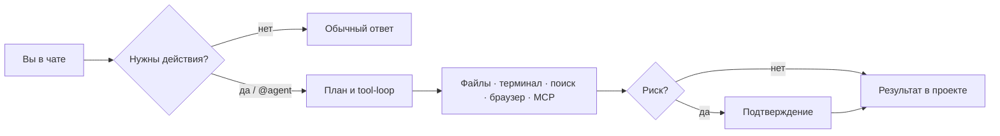

  <strong>KoviAIsoft</strong> 
  <em>Локальный чат и агент для Windows — ваши модели, ваш диск, без облака</em>

  
  
  
  
  

---

## Идея

**KoviAIsoft** — это desktop-приложение, в котором встречаются привычный локальный чат в духе LM Studio и агент, который умеет работать с проектом: читать и писать файлы, запускать команды, искать по коду.

Всё крутится у вас на машине. Модель загружается в память через **llama.cpp**, ответы стримятся в чат, а опасные действия агента проходят через подтверждение.

> Одна portable-папка → скопировали на ПК → запустили EXE → скачали GGUF → работаете.

Установка и сборка из исходников: **[INSTALL.md](INSTALL.md)**.

---

## Кому подойдёт

- Хотите **сильную локальную модель** без подписки и без отправки кода в чужой API  
- Нужен не только чат, а **помощь с файлами и командами** на Windows  
- Цените **контроль**: папка проекта, корни моделей, режимы Ask / Auto-safe / Full  
- Удобнее возить приложение **флешкой / папкой**, чем ставить стек вручную  

---

## Возможности

### Runtime под ваше железо

Приложение само смотрит на систему и ставит подходящий билд **llama.cpp** — CUDA, Vulkan или CPU. Поддерживаются современные архитектуры (в том числе вроде LFM3). Runtime можно обновлять тихо в фоне. Отдельный **монитор** показывает VRAM, скорость генерации и заполнение контекста.

### Модели без ручной возни

- Сканирование локальных `.gguf` и оценка «влезет / медленно / не пойдёт»  
- Рекомендации квантов под ваш VRAM и RAM  
- Скачивание с **Hugging Face** — в portable уже есть встроенный HF CLI  
- Своя папка загрузки, проверка GGUF, удаление модели с диска  
- Профили загрузки: баланс, мало VRAM, только CPU, автоподбор под ПК  

### Чат, который держит нить

Стриминг, температура и контекст, system prompt. Длинные диалоги сжимаются аккуратно: цель, план и затронутые файлы не выкидываются вместе с «хвостом» истории — working memory помогает модели не терять задачу.

### Агент для реальной работы

- План шагов и timeline процесса в UI  
- Инструменты: файлы, патчи, поиск, терминал (с адаптацией под Windows), веб, Playwright, MCP  
- `@agent …` или автоопределение coding/tool-задач  
- Для задач «напиши / реализуй» агент дожимает запись файлов, а не уходит в пустой текст  
- Подтверждения с превью diff и таймаутом, если диалог забыли  

### Безопасность по умолчанию

Доступ ограничен **папкой проекта** и каталогами моделей. Shell не уводит `cd` за пределы разрешённых корней; браузер режет SSRF, в том числе через redirect. Junctions и опасные системные пути учитываются. Сеть нужна для загрузки моделей/runtime и опциональных web-инструментов — сам чат с локальной моделью работает офлайн.

### Интерфейс

Первый запуск с онбордингом, несколько цветовых тем, единый чат для диалога и агента, настройки MCP и доступа к файлам — без отдельного «режима агента» в навигации.

---

## Как это выглядит в работе

1. **Runtime** — поставить llama.cpp под ваше железо.  
2. **Модели** — выбрать папку, скачать или указать GGUF, **загрузить в память**.  
3. **Настройки** — корень проекта (удобно положить туда `AGENTS.md`).  
4. **Чат** — обычные вопросы текстом; код и правки — через `@agent`.  
5. **Монитор** — следить за VRAM и tok/s во время длинных прогонов.  

Остановить генерацию можно кнопкой **Stop**.

---

## Технологии (кратко)

Electron · React · TypeScript · pnpm monorepo · llama.cpp · Hugging Face · Playwright · MCP.

| Пакет | Роль |
|-------|------|
| `apps/ui` | Интерфейс |
| `apps/desktop` | Оболочка Electron |
| `packages/core` | Агент, чат, runtime, tools |
| `packages/shared` | Типы и IPC |

---

## Документация

| Файл | Содержание |
|------|------------|
| **Этот README** | Что такое продукт и зачем он |
| **[INSTALL.md](INSTALL.md)** | Клонирование, dev, тесты, `pnpm pack`, portable EXE |

---

  Версия 0.1.0 · активная разработка · <a href="https://github.com/Koviand/KoviAIsoft">Koviand/KoviAIsoft</a>

